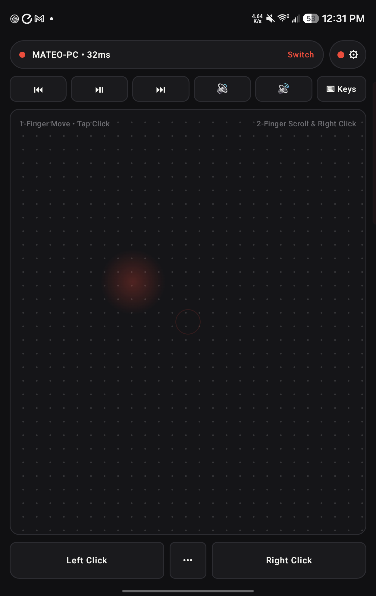
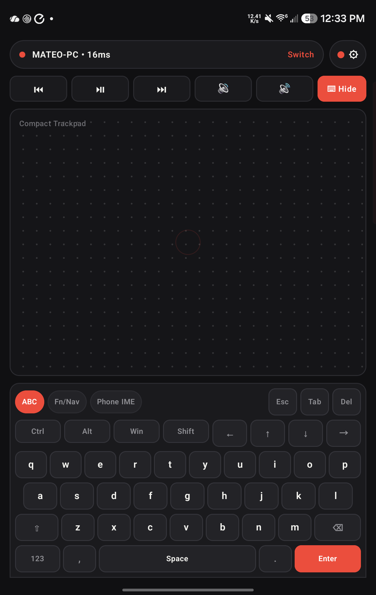
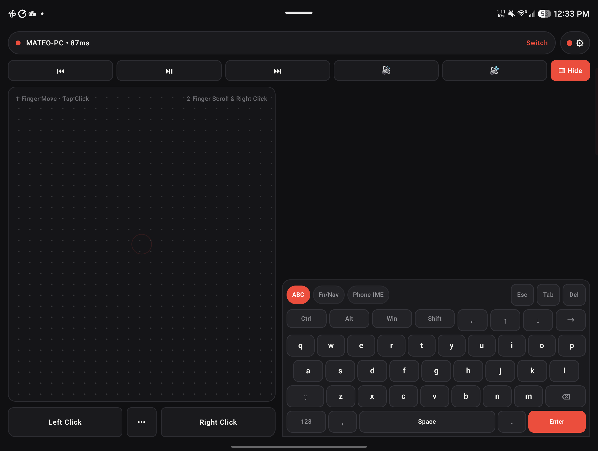
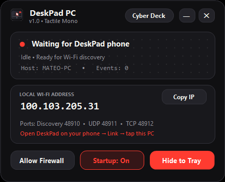

# DeskPad

Use an Android 9+ phone as a trackpad and keyboard for a Windows PC, over paired encrypted Wi-Fi or Bluetooth HID on compatible devices.

## Security update — 1.0.1

**Update both the Android app and PC receiver together.** Version 1.0's LAN receiver accepted input without authentication or encryption. Version 1.0.1 removes that protocol rather than retaining an insecure compatibility switch. See [security details and migration](docs/SECURITY.md).

Wi-Fi uses a pinned TLS 1.2+ connection and a unique PC pairing credential. Scan the PC's QR, or use the temporary six-digit PIN in its pairing window. Long credential entry remains an advanced fallback. The Windows receiver does not open its LAN listeners until it has verified the scoped firewall configuration. UDP port 48911 is no longer used for input.

## Quick start

1. Install the **1.0.1 `DeskPadPCSetup.exe`** on Windows. Approve its firewall migration prompt: it removes the old broad DeskPad rules and creates program-specific rules for **Private networks and the local subnet only**. The only allowed inbound ports are discovery **UDP 48910** and encrypted control **TCP 48912**. If migration fails or is canceled, Wi-Fi stays disabled. The portable receiver offers the same setup through **Allow Firewall**.
2. Open **Pair phone / Reset access** in DeskPad PC to show its private QR. Install the matching **1.0.1 `DeskPad.apk`** on Android and put both devices on the same trusted home LAN.
3. On the phone's main screen, tap **Scan QR**, allow camera access when requested, and point it at the PC's QR. The scan supplies the PC address and pairing credential and starts the pinned, authenticated connection. No PC selection or long code entry is needed first. Keep the QR private; a changed PC identity requires re-pairing.

**Use a PIN instead:** keep the PC's pairing window open. On the phone's main screen, tap **Enter PIN**, choose your PC, enter its six-digit PIN and tap **Pair**. The PIN expires after two minutes, five attempts across all clients, one successful pairing, or closing the PC window. Choose **New PIN** on the PC to start another window. Each Pair tap makes one attempt; there are no automatic PIN retries. Camera access is unnecessary for this path.

**Advanced fallback:** open **Link** on Android, select or enter the PC, then expand **Enter code manually** and use the PC's advanced text/copy option for the complete `DP2:` credential. This uses the same certificate pinning and token authentication. Camera permission is needed only for scanning.

**Hotel, guest and office networks:** do not change a shared network to Private just to make DeskPad work. Public and Domain profiles are blocked by DeskPad's rules. Use the separate Bluetooth mode when compatible, or your own trusted network. Authentication and encryption also protect the input channel if an untrusted device is on a network marked Private; they do not make every network or device trustworthy.

**Bluetooth alternative:** install the APK, pair phone and PC in system Bluetooth settings, then choose **Link → Bluetooth HID**, grant the requested permissions and select the paired PC. No PC companion is needed for Bluetooth. The phone must expose Android's HID Device profile.

## Features

- Touch trackpad with pointer acceleration, clicks, drag/hold, scrolling and zoom. Some gestures differ by transport.
- QWERTY, function and navigation decks, sticky PC modifiers, and a Phone IME text bridge.
- Tactile Mono and Cyber Deck themes.
- Side-by-side trackpad and keyboard when available width is at least 600dp **and the keyboard is open**. The retained connection owner is designed to survive Activity recreation; real-device fold/unfold behavior still needs validation.
- Small C# Windows Forms companion using Win32 `SendInput`, with tray controls and an optional startup setting.
- Main-screen **Scan QR** and **Enter PIN** pairing. The temporary PIN uses certificate-bound SRP-6a before importing the PC's normal credential; input still requires a separate pinned, authenticated connection.
- Pairing reset on the PC disconnects current phones and invalidates previously saved pairing secrets and QR codes.

## Interface screenshots

These existing repository images predate the security-update pairing UI. Their on-screen ping is not an input-latency benchmark.

| Compact trackpad | Keyboard |
| :---: | :---: |
|  |  |

| Wider workspace | Earlier Windows companion interface |
| :---: | :---: |
|  |  |

## Source layout and checks

- `app/`: Kotlin/Compose Android app (`com.deskpad.app`), version 1.0.1, version code 5, with direct main-screen QR and PIN pairing.
- `pc-companion/DeskPadPC.cs`: Windows interface and input injection adapter.
- `pc-companion/LanSecurity.cs` and `SecureServer.cs`: per-user identity, pairing and bounded TLS receiver.
- `pc-companion/PinPairing.cs`: temporary PIN enrollment using Bouncy Castle SRP-6a, globally bounded attempts and certificate binding.
- `pc-companion/FirewallRules.cs` and `.ps1`: checked firewall migration and read-only startup verification.
- `pc-companion/DeskPadSetup.cs`: per-user Windows installer and uninstaller.
- `pc-companion/deskpad_server.py`: alternative TLS receiver using Python's standard library; requires an explicitly provisioned PEM certificate/key and the advanced full-code pairing path. The temporary six-digit PIN belongs to the Windows C# receiver. See [Python setup](pc-companion/SECURE_PYTHON_RECEIVER.md). The non-Windows injection path is incomplete and is not a supported full Linux/macOS receiver.

Build Windows with `pc-companion/build_windows.ps1` using the .NET Framework 4.8 runtime/compiler. The Android build uses Gradle 8.11.1, JDK 21, SDK 35, AGP 8.7.2 and Kotlin 2.0.21. No Gradle wrapper is checked in.

Security regression checks use recording injectors, not the user's desktop:

```powershell
pc-companion/test_windows_security.ps1
pc-companion/test_firewall.ps1
python -B -m unittest discover -s pc-companion -p 'test*server.py' -v
```

The cross-runtime test additionally checks a Python TLS client against the C# receiver. Independent PIN checks compare Java and C# SRP values and exercise the production C# server over loopback TLS with a recording injector. Android tests cover QR/PIN pairing, exact pin matching, framing, legacy discovery rejection and session queues; they do not replace device testing. A build or decoder test alone does not establish successful camera scanning, physical PIN entry, Android Keystore operation, phone-to-PC input, Bluetooth compatibility or Fold continuity. Installation and device results must be reported separately.

The source is publicly available. No project LICENSE file is currently included; public visibility alone does not establish an open-source license. Dependency attribution and license copies are listed in [THIRD_PARTY_NOTICES.md](THIRD_PARTY_NOTICES.md); Android QR/PIN notices are also included inside the APK under `assets/licenses/`. Release builds currently use the existing Android debug signing configuration, and Windows packages are not publisher-signed.
